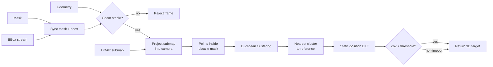

# get_seg_3d_coord

**Estimate the 3D position of a detected object by fusing segmentation masks, 2D detections, a LiDAR submap and odometry, then smoothing it with an EKF.**


Developed for RoboCup@Home 2026 (team Inha-United) on the RB-Y1 mobile manipulator. The output is the target point a navigation or approach module drives to.

---

## Why

A camera tells you *what* the object is, a LiDAR tells you *where* points are. Neither alone gives a stable 3D target:

- single-frame depth from a mask is noisy at the edges,
- raw Livox frames are sparse, so a small object may get only a few points,
- measurements taken while the robot is turning are smeared by TF/time mismatch.

`local_search` projects a recent LiDAR **submap** into the camera, keeps only points inside both the detection box and the mask, and feeds the selected cluster into a static-position **EKF** that returns once its covariance converges.

## Pipeline



1. Synchronize the mask and bbox streams (approximate time, 0.2 s slop).
2. Reject the measurement if the robot's angular velocity over the last 0.3 s exceeds 0.20 rad/s.
3. Project one recent submap cloud into the camera at the mask timestamp.
4. Keep points inside the bbox and the mask.
5. Cluster the selected points.
6. Pick the cluster nearest to the reference position from the action goal (within 1.5 m).
7. Update the EKF; return when the covariance drops below `ekf_converged_variance` or after `ekf_timeout_sec`.

## Nodes

| Executable | Interface | Role |
|---|---|---|
| `local_search` | action `local_search` | Main path: mask + bbox + submap + odometry → EKF-filtered 3D target |
| `local_search_logger` | subscribes to `local_search` points, diagnostics and the mask | Writes per-frame images, point clouds and CSV in a separate process so disk I/O never blocks the action |
| `table_person_association` | action `associate_cluster` | Earlier variant: mask + raw Livox frames with decay accumulation, clusters for tables and people |

### `local_search` topics

| Topic | Direction | Default |
|---|---|---|
| Mask | in | `/sam2_segmentation_node/binary_mask/compressed` |
| Detection bbox | in | `/detection/bbox_stream` |
| LiDAR submap | in | `/approach/submap_cloud` |
| Camera info | in | `/camera/camera_head/color/camera_info` |
| Odometry | in | `/odom` |
| Selected points | out | `~/points` |
| Cluster centers | out | `~/cluster_centers` |
| Clustered points | out | `~/clustered_points` |
| RViz markers | out | `~/cluster_markers` |
| Frame diagnostics | out | `~/frame_diagnostics` |

## Requirements

- ROS 2 (developed on the robot's Jetson; distro: `TODO`)
- PCL, Eigen3, OpenCV (`cv_bridge`), `message_filters`, `vision_msgs`
- `inha_interfaces` — the team's action/message package, not included here. It must be in the same workspace.

## Build

```bash
cd ~/robocup_ws/src
git clone https://github.com/PGW63/get_seg_3d_coord.git
cd ~/robocup_ws
rosdep install --from-paths src --ignore-src -r -y
colcon build --packages-select get_seg_3d_coord --cmake-args -DCMAKE_BUILD_TYPE=Release
source install/setup.bash
```

## Run

```bash
ros2 launch get_seg_3d_coord segmented_lidar_cluster.launch.py
```

Starts `table_person_association`, `local_search` and `local_search_logger` with [`config/params.yaml`](config/params.yaml). Set `pointcloud_topic` to your submap topic before real experiments.

## Key parameters (`local_search`)

| Parameter | Default | Meaning |
|---|---|---|
| `submap_timeout_sec` | 3.0 | Max age of the submap used for one measurement |
| `require_stable_odom` | true | Reject measurements while the robot rotates |
| `max_relative_angular_velocity_rad_s` | 0.20 | Rotation limit for a stable frame |
| `odom_stable_window_sec` | 0.3 | Window over which stability is checked |
| `prefilter_{x,y,z}_{min,max}` | 0.5–5.0 / ±2.0 / 0.3–1.5 m | Box in `base` frame applied before projection |
| `cluster_tolerance` | 0.30 m | Euclidean clustering distance |
| `max_distance_from_reference_m` | 1.5 | Gate around the goal's reference position |
| `ekf_initial_variance` (P0) | 1.0 | Initial uncertainty |
| `ekf_measurement_variance` (R) | 0.09 | Trust in one cluster measurement |
| `ekf_process_variance_per_sec` (Q) | 0.0025 | Covariance growth over time |
| `ekf_converged_variance` | 0.01 | Return threshold |
| `ekf_timeout_sec` | 10.0 | Give up and return the current estimate |

## Tuning the EKF without ground truth

Measurement noise depends on segmentation quality, calibration, submap density and robot motion, so R and Q cannot be set analytically. The package logs every run and the parameters are swept offline:

- **NIS consistency** — normalized innovation squared should follow a χ² distribution with 3 degrees of freedom.
- **Pseudo-GT MAE** — the median of the last stable samples is used as a pseudo ground truth.

Full workflow: [docs/ekf_tuning.md](docs/ekf_tuning.md).

## Diagnostics

Every frame is logged with a status so failures can be counted, not guessed:

`ok` · `partial_match` · `input_timeout` · `cloud_timeout` · `no_requested_bbox` · `unstable_odom` · `projection_failed` · `no_bbox_candidate` · `no_matching_lidar` · `no_cluster` · `no_target_cluster`

Log layout and CSV columns: [docs/logging.md](docs/logging.md).

## Repository layout

```text
get_seg_3d_coord/
├── config/params.yaml            # parameters for all three nodes
├── docs/
│   ├── ekf_tuning.md             # offline EKF parameter sweep
│   └── logging.md                # frame logs and CSV columns
├── include/get_seg_3d_coord/
│   ├── cluster_extractor.hpp     # Euclidean clustering
│   ├── local_search_types.hpp
│   ├── point_selector.hpp        # projection + bbox/mask selection
│   ├── position_ekf.hpp          # static-position EKF
│   └── state_odometry.hpp        # odometry buffer and stability check
├── launch/segmented_lidar_cluster.launch.py
└── src/
    ├── local_search.cpp          # main action server
    ├── local_search_logger.cpp   # out-of-process logger
    ├── table_person_association.cpp
    └── ...                       # implementations of the headers above
```

## Limitations

- The target is assumed static during a search.
- Accuracy against measured ground truth has not been reported yet. `TODO`

## Related

- [approach](https://github.com/PGW63/approach) — picks a manipulation-ready pose around this target.

## Author

Gunwoo Park ([@PGW63](https://github.com/PGW63)) — Inha University, Smart Mobility Engineering
